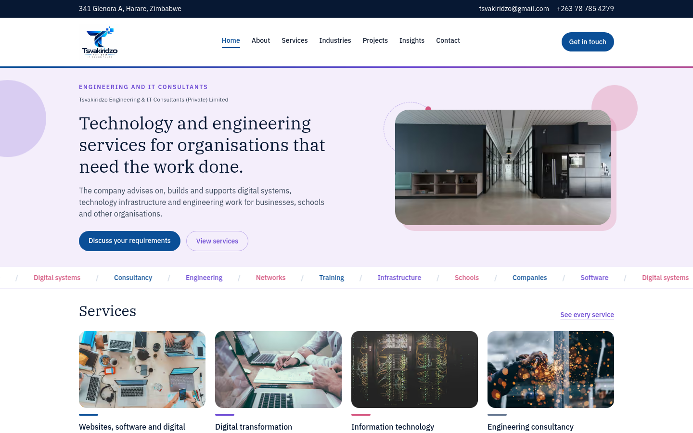

# Tsvakiridzo Engineering & IT Consultants — Company Website

**Live:** https://tsvakiridzo-website.vercel.app/

Marketing website for Tsvakiridzo Engineering & IT Consultants (Private) Limited, a Harare-based technology and engineering services company.



## Features
- Pages for services, industries served, projects, insights, about, contact and privacy
- Content kept in typed data files (`src/content/`) so pages are easy to update
- Enquiry form with Zod validation and server-side email delivery (Nodemailer API route)
- SEO: metadata helpers, `sitemap.ts`, `robots.ts`, app icons
- Scroll-reveal animations and a responsive header/footer

## Tech stack
Next.js (App Router) · React · TypeScript · Tailwind CSS · Zod · Nodemailer · Vercel

## Run locally
```bash
npm install
cp .env.example .env.local   # SMTP settings for the enquiry form
npm run dev
```

## Author
Tadiwanashe Muteera · tdmuteera@gmail.com
